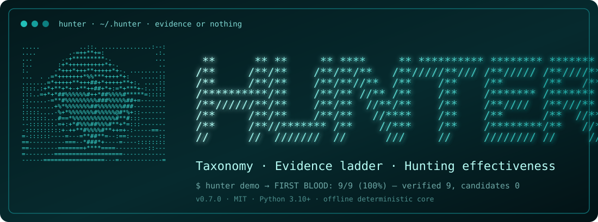
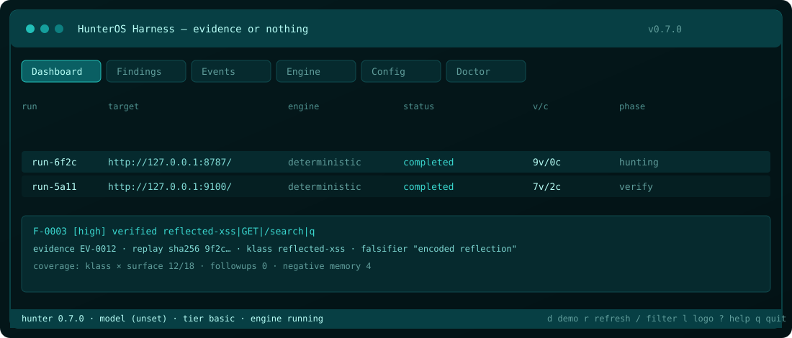
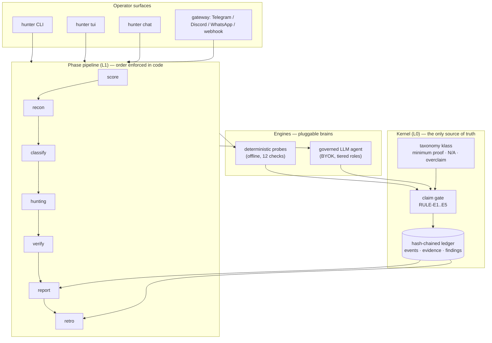
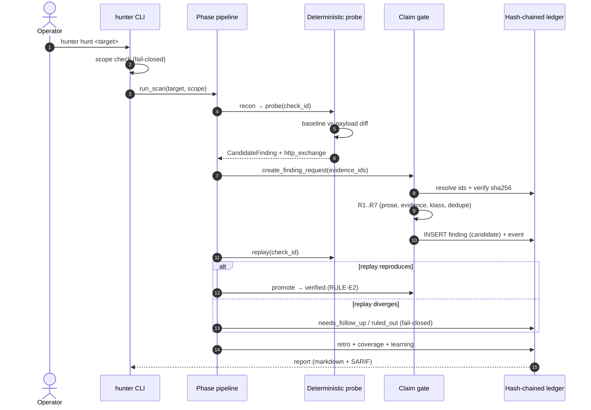

# HunterOS Harness

<p align="center">
  
</p>

<p align="center">
  <a href="https://github.com/zaaaxx11/HunterOsHarness/actions/workflows/ci.yml"></a>
  
  
  
  
</p>

```text
 **      ** **     ** ****     ** ********** ******** *******     *******    ********
/**     /**/**    /**/**/**   /**/////**/// /**///// /**////**   **/////**  **//////
/**     /**/**    /**/**//**  /**    /**    /**      /**   /**  **     //**/**
/**********/**    /**/** //** /**    /**    /******* /*******  /**      /**/*********
/**//////**/**    /**/**  //**/**    /**    /**////  /**///**  /**      /**////////**
/**     /**/**    /**/**   //****    /**    /**      /**  //** //**     **        /**
/**     /**//******* /**    //***    /**    /********/**   //** //*******   ********
//      //  ///////  //      ///     //     //////// //     //   ///////   ////////
```

**The security-audit harness whose LLM cannot fabricate findings.**
Every finding must be backed by tamper-evident evidence in a hash-chained
ledger. The database is the only ledger; reports render only from it; the
claim gate vetoes any claim the ledger cannot prove.

> **Scope discipline** — scan only systems you own or are explicitly authorized
> to test. Authorization is your responsibility; enforcement is the harness's.
> The scope gate is fail-closed and lives in the HTTP client, before the socket
> opens.

---

## Contents

- [Why HunterOS](#why-hunteros)
- [Quick start](#quick-start)
- [Framework](#framework)
- [Workflow](#workflow)
- [Bug-class taxonomy](#bug-class-taxonomy)
- [Hunting effectiveness](#hunting-effectiveness)
- [Operator surface](#operator-surface)
- [Commands](#commands)
- [Architecture](#architecture)
- [Safety](#safety)
- [Development](#development)
- [Docs](#docs)
- [Status](#status)
- [License](#license)

---

## Why HunterOS

Prompt-only agents are *asked* not to fabricate. HunterOS makes fabrication
**structurally impossible**:

- The LLM's only write path is a machine-validated `create_finding_request`.
  Evidence ids are re-resolved and re-hashed against the ledger.
- A self-written note can never carry a finding — at least one real
  `http_exchange` is required.
- `verified` is decided by a deterministic replay, never by the model.
- Findings carry a bug-class `klass`, a `falsifier` (what would disprove it),
  and an evidence ladder: `theoretical → candidate → verified`.

Trust the chain, not the chat.

## Quick start

**Install (macOS / Linux):**

```bash
curl -fsSL https://raw.githubusercontent.com/zaaaxx11/HunterOsHarness/main/install.sh | bash
```

**Install (Windows / PowerShell):**

```powershell
powershell -NoProfile -ExecutionPolicy Bypass -Command "irm https://raw.githubusercontent.com/zaaaxx11/HunterOsHarness/main/install.ps1 | iex"
```

Both installers create a dedicated venv at `~/.hunteros/venv`, register
`hunter` and `hunt` shims, and start the onboarding wizard on first run. State
lives in `~/.hunter` (`config.yaml`, `keys.env`, `ledger.db`); legacy
`~/.hunteros` state is migrated (copy-forward) on first run and the originals
are never deleted.

**First blood in one command — no API key, fully offline:**

```bash
hunter                 # welcome panel + next steps
hunter demo            # boots PracticeVault on 127.0.0.1, scans, scores
hunter report          # markdown + SARIF, rendered from the ledger only
hunter tui             # interactive dashboard
```

`hunter demo` expects **≥ 7/9 first-blood** on the planted practice target and
shuts the server down afterwards.

**Bring a brain (optional):**

```bash
export OPENAI_API_KEY=sk-...       # or ANTHROPIC_API_KEY / OPENROUTER_API_KEY
export HUNTEROS_MODEL=gpt-4o
hunter chat                        # governed audit on hunt intent
hunter hunt http://127.0.0.1:8941/ # one-shot governed hunt
```

Non-localhost targets require an authorized scope manifest:

```bash
hunter scan https://target.example.com --scope scope.manifest.json
```

### Providers, roles, and the optional browser

Model roles are `orchestrator`, `hunter`, `verifier`, and `utility` (legacy
`planner` / `exploit` / `verify` names are accepted on load and canonicalized on
the next config write). Add any OpenAI-compatible provider:

```bash
hunter config provider add lab-vllm --base-url http://10.0.0.9:8000/v1
hunter config provider test lab-vllm --model mistralai/Mistral-7B-Instruct-v0.4.0
```

Browser automation is optional and hunt-only: `pip install 'hunteros-harness[browser]'`
then `python -m playwright install chromium`. Browser actions are scope-gated
and available only inside an authorized hunt; normal chat stays browser-free.

The 24/7 engine boots once with `hunt start` (no target needed) and is managed
with `hunt status`, `hunt logs`, and `hunt stop`; queue hunts with
`hunt start --target <url> --time 2h`.

## Framework

<p align="center">
  
</p>



ASCII fallback:

```text
surfaces ──► phase pipeline ──► engines ──► claim gate ──► ledger
  CLI          score  recon      deterministic   RULE-E1..E5    events
  TUI          classify hunting  LLM agent       taxonomy       evidence
  CHAT         verify  report                    klass          findings
  GATEWAY      retro                            falsifier      (append-only)
                                                      │
                                                      └──► report / retro (ledger-only)
```

## Workflow

### Continuous hunting (RAG — internal, not a command)

`hunter hunt` is the single entry point. Give it a URL, a repo, a local
directory, several targets, or a free-form description; the harness recognizes
the target kind (LLM-assisted), builds a scope manifest, and keeps the daemon
queue fed so hunting never idles. Every finding spawns follow-up hunts until
the `--time` budget is spent.

```mermaid
flowchart TB
    subgraph Input["hunter hunt <input>"]
        T1["URL / host"]
        T2["git repo / local dir"]
        T3["smart contract"]
        T4["free-form description<br/>(LLM extracts targets)"]
    end

    subgraph Recognize["Scope recognizer (LLM, utility tier)"]
        REC["classify kind:<br/>url · repo · smartcontract · api · web"]
        SCOPE["scope manifest per target<br/>(hosts · local_roots)"]
        REC --> SCOPE
    end

    subgraph Daemon["24/7 daemon (queue)"]
        Q["task queue (high-water 8)"]
        W["hunt worker<br/>mount_local_dir for local targets"]
        RUN["run_scan → pipeline"]
        Q --> W --> RUN
    end

    subgraph RAG["RAG loop (internal)"]
        FIND["read findings (candidate / theoretical / verified)"]
        WONDER["LLM wonder: 4 child hunts per finding<br/>+ parent_finding_id"]
        SEED["seed variants when queue drains"]
        DEDUP["dedup vs task/claimed/done + followed set"]
        FIND --> WONDER --> DEDUP
        FIND --> SEED --> DEDUP
        DEDUP --> Q
    end

    T1 --> REC
    T2 --> REC
    T3 --> REC
    T4 --> REC
    SCOPE --> Q
    RUN --> LEDGER2[("hash-chained ledger")]
    LEDGER2 --> FIND
```



ASCII fallback:

```text
hunt <input> ──► scope recognizer ──► daemon queue ──► run_scan ──► ledger
 (url/repo/dir/      (LLM classify,      (high-water 8)    │            │
  description)        scope manifest)                       │            ▼
                                          RAG loop ◄────────┘     findings
             finding ──► 4 child hunts (parent_finding_id) ──► queue
             no finding ──► seed variants ──► queue
             dedup: task/claimed/done + followed set
```

### One hunt (deterministic path)


## Bug-class taxonomy

`src/hunter/_data/taxonomy/klasses.json` defines the vocabulary every finding
is filed under. Each class carries anti-fabrication substance: **minimum proof**,
**common N/A patterns**, and **overclaim traps** — so the hunter and the agent
share one definition of "what counts".

| klass | CWE | lane | severity hint |
| --- | --- | --- | --- |
| `missing-headers` | CWE-693 | web2 | info |
| `info-disclosure` | CWE-200 | web2 | medium |
| `reflected-xss` | CWE-79 | web2 | high |
| `sql-injection` | CWE-89 | web2 | high |
| `path-traversal` | CWE-22 | web2 | high |
| `open-redirect` | CWE-601 | web2 | medium |
| `access-control` | CWE-862 | web2 | high |
| `csrf` | CWE-352 | web2 | medium |
| `ssrf` | CWE-918 | web2 | high |
| `ssti` | CWE-1336 | web2 | high |
| `xxe` | CWE-611 | web2 | high |
| `race-condition` | CWE-362 | web2 | high |
| `cors` | CWE-942 | web2 | medium |
| `reentrancy` | CWE-841 | web3 | critical |
| `oracle-manipulation` | CWE-346 | web3 | critical |
| `access-control-web3` | CWE-284 | web3 | critical |
| `signature-replay` | CWE-294 | web3 | high |
| `network-exposure` | CWE-200 | network | medium |

The ledger validates every klass (`RULE-E5`) and refuses unknown values; the
probe registry maps each deterministic `check_id` onto its class.

## Hunting effectiveness

Five mechanisms make the deterministic core effective without lowering the
evidence bar:

1. **Signal classification** (`engine.signals`) — every exchange is classified
   `clean · signal · ambiguous · waf · soft-404 · ratelimit · transport ·
   crash`. A WAF block or a soft-404 can no longer masquerade as a clean
   response (the main source of false negatives).
2. **Coverage matrix** (`workflow.coverage`) — `klass × surface` gaps are
   computed from ledger events, so "done" is honest and blind spots surface
   first.
3. **Learning loop** (`agent.learning`) — post-hunt review promotes patterns
   seen on ≥2 targets, records negative results as facts, and tracks skill use.
4. **Adversary in the loop** — an optional challenger argues against each
   candidate before the deterministic replay; the replay remains final.
5. **Lane fan-out** (`agent.lanes`) — seven lanes (recon, web2, web3, network,
   chainer, verifier, curator) with independent budgets; the ledger is injected
   as context into `build_goal`, never typed by hand.

### Skills and curator

Local methodology cards live under `~/.hunter/skills/<name>/SKILL.md`. The
merged corpus marks every card with its source — `[bundled]`, `[user]`, or
`[quarantined]` — matches at most five per turn, and never mounts a quarantined
card into a prompt. `/curate` and `hunter curate` preview retro-derived cards
before an explicit y/N save; flagged drafts stay inert until reviewed.

## Operator surface

The Textual dashboard is a **view over the ledger**, never a second source of
truth:

- tabs: Dashboard · Findings · Events · Engine · Config · Doctor
- `d` demo · `r` refresh · `/` filter findings · `l` logo · `s`/`x` engine
  start/stop · `1–4` tabs · `?` help · `q` quit
- live event tail, severity/status color language, evidence drill-down
- tosca palette (`#00FFE5` base) with a seven-step gradient shared by CLI,
  REPL, TUI, and daemon output

## Commands

| Command | What it does |
| --- | --- |
| `hunter` | welcome panel + next steps |
| `hunter init` | configure provider, key, and model in one wizard |
| `hunter demo` | offline first blood on PracticeVault |
| `hunter hunt <target>` | one-shot governed hunt (auth gate) |
| `hunter scan <target> --scope <json>` | manifest-required pipeline scan |
| `hunter report` | markdown + SARIF from the ledger |
| `hunter retro --run <id>` | deterministic retrospective |
| `hunter tui` | interactive dashboard |
| `hunter chat` | REPL with sessions and 25 slash commands |
| `hunter doctor` | environment, ledger chain, providers, chat DB |
| `hunter verify` | recompute the hash chain |
| `hunter gateway status` | inspect the 24/7 engine |
| `hunt start --target <url> --time 2h` | boot the engine and queue a hunt |
| `hunt status` / `hunt logs` / `hunt stop` | manage the 24/7 engine |
| `hunter update` | GitHub-first, PyPI-fallback upgrade |

Exit codes are stable: `0` clean, `1` error, `2` findings, `3` refused/usage.

## Architecture

1. **Kernel (L0)** — append-only, hash-chained event ledger + claim gate.
   Findings without bound evidence are structurally impossible to insert.
2. **Phase pipeline (L1)** — `score → recon → classify → hunting → verify →
   report → retro`; every gate reads the ledger, nothing else.
3. **Engines** — pluggable brains behind `EngineDriver`: deterministic probes
   (offline, 12 checks) and the governed LLM agent. The brain changes; the
   evidence contract does not.
4. **Scope gate** — fail-closed, structural, enforced in the HTTP client before
   the socket opens.

```text
src/hunter/
  kernel/     ledger · events · findings · claimgate · redaction
  workflow/   phases · pipeline · bench · eval_cli · coverage · reporting
  engine/     base · deterministic/probes · signals · llm
  agent/      tools · loop · debunk · lanes · learning · skills · curator
  tui/        Textual dashboard
  cli/        typer commands · doctor · daemon · config
  _data/      branding · doctrine · taxonomy
```

Deeper invariants and the L1–L5 framing: [docs/ARCHITECTURE.md](docs/ARCHITECTURE.md).

## Safety

- Scope manifests, a fail-closed scope gate, and a target-required
  authorization prompt for non-localhost hosts.
- Evidence is deep-redacted before storage (`RULE-E3`); raw secrets never enter
  the ledger.
- `shell_exec` classifies commands (`readonly` / `mutating` / `catastrophic`);
  mutating actions need an explicit `/approve <id>` (single-use, 300-second TTL).
- The gateway is default-deny with allowlists, HMAC-signed webhooks, anti-replay
  signatures, and turn leases.
- No DoS, no credential bruteforce, no mass PII, no social engineering.

## Development

```bash
python -m venv .venv
.venv/Scripts/pip install -e ".[dev]"      # Windows
# source .venv/bin/activate && pip install -e ".[dev]"   # macOS / Linux

python -m pytest tests -q                  # offline suite
python -m ruff check src tests
python -m mypy src/hunter
```

`tests/regression.yaml` drives the honest eval (`hunter.workflow.eval_cli`):
each cell runs the PracticeVault demo in its own tmp state dir and is scored
ledger-only against `answer_key.json`.

## Docs

| Doc | Contents |
| --- | --- |
| [QUICKSTART.md](QUICKSTART.md) | 60-second setup |
| [docs/ARCHITECTURE.md](docs/ARCHITECTURE.md) | layers, invariants, governance |
| [docs/LLM.md](docs/LLM.md) | providers, roles, budgets |
| [docs/GATEWAY.md](docs/GATEWAY.md) | Telegram / Discord / WhatsApp / webhook |
| [docs/PORTABILITY.md](docs/PORTABILITY.md) | platforms, shells, WSL2 |
| [docs/FIRST-RUN.md](docs/FIRST-RUN.md) | first-run transcripts |
| [checks/PRE-REPORT.md](checks/PRE-REPORT.md) | pre-report gate |
| [CHANGELOG.md](CHANGELOG.md) | release history |

## Status

**v0.7.0** — bug-class taxonomy and evidence ladder, in-place ledger migration
(`user_version = 2`), signal classification, coverage matrix, lane fan-out,
learning loop, challenger wiring, ledger-as-context, an honest eval harness,
and a tosca-gradient TUI with the HunterOS emblem.

## License

MIT — see the `license` field in [pyproject.toml](pyproject.toml).
